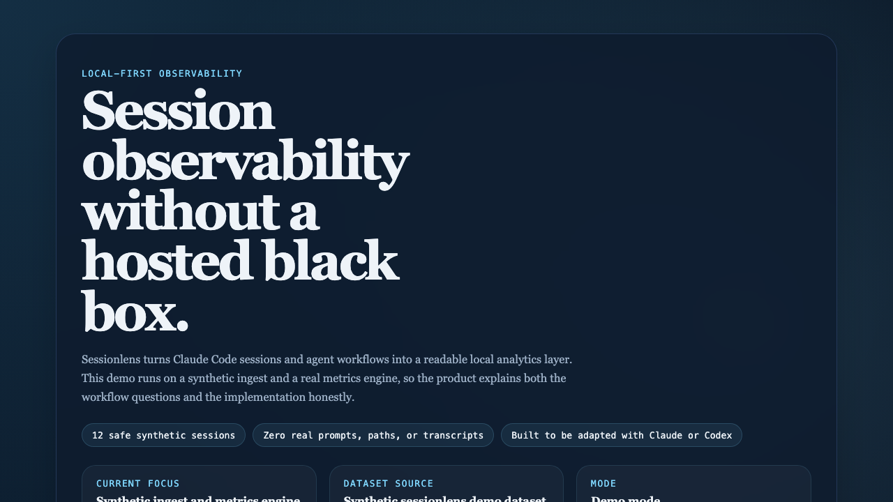

# Sessionlens

`sessionlens` is a local-first analytics and observability tool for Claude Code sessions and agent workflows.

It is designed as a standalone local-first product: teachable architecture, safe demo data, and a clear path for adapting the analytics layer to a developer's own local workflow data.



Synthetic dashboard capture rendered from the committed demo dataset and metrics engine.

## Status

This repo is now at the launch-candidate stage.

The current goal is to finish the public-launch gate:
- a clean repo history
- a safe OSS baseline
- a polished demo path
- strong adaptation docs
- CI and verification
- a completed public-safety review

## Product Direction

### Core promise
Help people understand where their time, tokens, tools, and agent orchestration are paying off, without sending local usage data to a hosted service.

### Intended users
- Claude Code power users
- developers experimenting with agentic workflows
- technical teams who want local analysis before adopting a hosted observability product

### What v1 is meant to include
- local-first ingestion for Claude Code session metadata
- demo mode with fictional session data
- session and project trend views
- agent and orchestration visibility
- token, cost, and friction analytics

### What v1 is not meant to include
- individualized coaching or personal quality scoring
- direct ticket or task-management analytics
- machine-specific automation
- private prompts, transcript text, or deep-insight caches as the core product

## Quick Start

```bash
npm install
npm run dev
```

Then open `http://localhost:3000`.

## Demo Assets

The repo now includes committed demo-safe assets for screenshots and social previews:

- [dashboard screenshot](demo/sessionlens-dashboard-hero.png)
- [dashboard poster](demo/sessionlens-dashboard-poster.svg)
- [social preview](demo/sessionlens-social-preview.svg)

These are built from the public-safe product story, not from any real usage history.

## Repo Structure

```text
src/app/
  layout.tsx         App shell and metadata
  page.tsx           Initial dashboard-style landing page
  globals.css        Global styling for the scaffold

src/lib/
  demo-data.ts       UI-facing view model built from the analytics layer
  sessionlens/
    types.ts         Public-safe normalized session schema
    demo-fixtures.ts Synthetic session fixtures
    ingest.ts        Demo ingest interface and source boundary
    metrics.ts       Derived overview, project, tool, and capability analytics

docs/
  Reserved for architecture notes and future implementation docs

demo/
  Reserved for synthetic datasets and screenshots
```

## Implementation Map

These are the main areas this repo is expected to grow into:

- ingestion adapters
  Read local Claude Code artifacts and normalize them into a public-safe analytics shape.
- normalized data model
  Convert raw local metadata into a stable session/project/agent schema.
- metrics engine
  Compute cost, throughput, friction, and orchestration metrics.
- dashboard views
  Present session, project, and agent trends without leaking private text.
- demo mode
  Let people explore the product using synthetic data before pointing it at their own environment.

## Customization Guide

If someone wants to adapt `sessionlens` for personal use, the eventual flow should be:

1. Start with demo mode.
2. Point the ingest layer at a local session directory.
3. Map local fields into the normalized schema.
4. Decide which metrics to expose and which sensitive fields to suppress.
5. Adjust the UI for the questions they care about most.

Expected customization points:
- local data directory and file layout
- normalized session schema
- metric definitions
- dashboard sections
- privacy rules for what can appear in screenshots or demo exports

## Known Limitations

- The repo is still demo-first; filesystem ingest is the next implementation step.
- The current visuals are intentionally lightweight and dependency-minimal.
- The synthetic dataset is meant to demonstrate the product shape, not model every real workflow edge case.

## Privacy Model

The public repo is designed around a hard separation between analytics structure and sensitive content.

Safe analytics examples:
- session duration
- tool counts
- token counts
- coarse outcome and friction categories
- agent usage flags
- project-level comparisons built from fictional names

Sensitive data that should stay out of public fixtures and screenshots:
- real prompts
- raw transcript text
- real project paths
- private summaries
- personal schedules or working-pattern details

## For Claude / Codex

This repo is meant to be adaptable with an AI coding agent.

Read these files first:
- `README.md`
- `src/app/page.tsx`
- `src/lib/demo-data.ts`
- `src/lib/sessionlens/types.ts`
- `src/lib/sessionlens/ingest.ts`
- `src/lib/sessionlens/metrics.ts`
- `src/app/globals.css`

Safest places to start changing the repo:
- `src/lib/demo-data.ts` for copy, sample metrics, and UI content
- `src/lib/sessionlens/demo-fixtures.ts` for synthetic inputs
- `src/lib/sessionlens/metrics.ts` for derived analytics
- `src/app/page.tsx` for dashboard structure
- `README.md` for product framing and customization instructions

What is intentionally missing right now:
- user-provided filesystem ingest
- any direct import of non-demo private data sources

## OSS Baseline

- License: Apache-2.0
- Security policy: [SECURITY.md](SECURITY.md)
- Contribution guide: [CONTRIBUTING.md](CONTRIBUTING.md)
- Launch review: [docs/release-readiness.md](docs/release-readiness.md)
- Public-safety review: [docs/public-safety-review.md](docs/public-safety-review.md)

## Next Steps

- build the first filesystem ingest adapter
- deepen the synthetic dataset and add richer demo slices
- add optional export flows for screenshots or hosted demo pages
- complete the final GitHub settings pass and tag the first release
